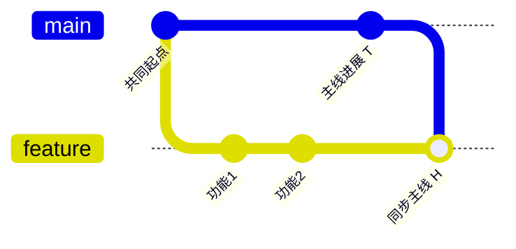
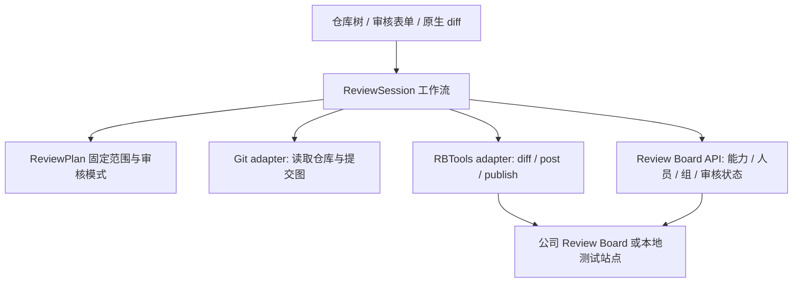

# 实现思路与方向

状态：设计基线。现在已实现 0.6.0 的原生视图、范围分析、预览、提交、评论阅读和待审收件箱；当前代码与验证边界见
[扩展开发与验收](extension.md) 和 [最终 Diff/HEAD 绑定](final-diff.md)。下文保留最初的方向和后续设计，不能把所有目标都视为已实现。
本次通过合成仓库确认了若干行为；尚未拿到公司真实仓库、服务版本、配置和错误日志，
所以不能断定实际工作中的所有失败都是同一原因。

## 产品范围

用户的核心任务是：在当前 VS Code 项目中明确“这次审什么”，预览后提交到正确的审核单，
随后根据反馈更新，最后在满足团队流程时合入目标分支。

| 用户操作 | 对应能力 | 当前状态 |
| --- | --- | --- |
| 识别当前项目 | 枚举 Git 仓库、分支、remote、工作区状态 | 已实现 |
| 选择对比范围 | 选择目标主线/基线，解释范围中的 merge | 已实现；HEAD 为当前提交 |
| 图形化对比 | 文件列表 + VS Code 原生 diff 编辑器 | 已实现 |
| post / 更新 | 草稿、新建或明确指定审核单 ID、错误恢复 | 已实现，部分失败保留待确认状态 |
| 审批人、审批组、bug 号 | API 搜索人/组，表单输入并校验 | 已实现 |
| 发布审核 | 与保存草稿分开；展示操作结果和审核链接 | 已实现 |
| 统一对比与审阅 | 本地预览、自己提交、他人 ID；服务器文件、版本、原生行内评论和 Ship It | 已实现；公开评论/回复可读，回复写入和 issue 操作仍需网页 |
| 待审收件箱 | 直接/组分配、内容更新通知、本地已读状态 | 已实现；当前连接轮询，不引入复杂审批状态机 |
| 仓库默认配置 | 常用字段直接编辑，低频设置收起，跨窗口沿用默认值 | 已实现；按规范 worktree 根区分 |
| 合并分支 / land | 独立写操作流程、冲突和恢复、审核状态核对 | 后续阶段 |

插件无需重复实现 Git GUI 的所有功能。第一版覆盖已提交修改；工作区/暂存区有改动时明确
显示“未包含”，不能把这些文件的当前内容混入基于 commit 的预览。暂存、提交、任意挑选
不连续 commits、跨仓库批量审核等应后置。

## 已确认的行为

1. RBTools 是客户端，审核服务端是 Review Board。最终扩展连接公司的服务器，
   本仓库的本地服务只用于开发和回归，不作为插件运行时必需的后端。
2. RBTools 7.0 的 `GitClient.get_commit_history()` 遇到多个 parent 时拒绝 with-history
   上传。本次真实复现了该错误，不能把它简单归结为 Git 仓库损坏。
3. `rbt post --squash-history BASE HEAD` 可上传合并范围的汇总 diff，保留本地 commit 和分支。
   这是“审核展示不携带逐提交历史”，并不执行 `git squash`、`rebase`、`reset` 或 push。
4. 新审核单和更新审核单不同。更新时 RBTools 按原审核单 `created_with_history` 决定模式；
   旧单是 history 模式时，添加 `--squash-history` 不能转换它。本次已复现仍拒绝 merge。
5. 默认 `post` 产生草稿。未发布草稿中的 diff 可被替换；已发布后再次上传才形成后续
   diff revision。因此“post 成功”“已发布”和“产生第 2 版 diff”必须分别判断。
6. 当前版本 `rbt post --json` 给出审核单 ID/URL；实测 `rbt diff --json` 只给出 success 状态，
   不包含 patch。预览必须读取普通 `rbt diff` 的原始字节输出，不能把通用 JSON 选项当成
   所有子命令都提供完整数据的保证。`diff` 目前还会连接服务端读取能力，不是完全离线命令。

以上限于已验证的 Review Board 7.0.6 / RBTools 7.0。公司旧版本需要单独建立兼容性测试。

## Git 范围必须有明确语义

不能通过“最近 N 条提交”、提交时间或分支名推测审核内容。应固定解析后的 SHA，再做预览和提交。

### 默认：功能分支相对目标主线的净改动

用户选择目标主线 `T` 和功能分支目标 `H`。执行：

```text
T = git rev-parse <target-ref>^{commit}
H = git rev-parse <head-ref>^{commit}
B = git merge-base --all T H
审核范围 = B -> H
```

有且只有一个 merge base 时，`git diff T...H` 表示该范围；预览和上传都使用已固定的 `B H`。
`git diff T H` 直接比较两个树，目标主线独有的提交可能以反向改动出现在结果中，不能和
“功能分支相对共同基线的改动”混为一谈。`git log A..B` 又是可达提交集合，不等于文件差异语义。



在这个例子中，merge base 为 `T`，审核 `T -> H`，主线已有文件不会被重复当成功能改动。
如果同步之后主线又前进，共同基线可能早于当前 `T`，界面也应显示该事实。

异常必须有可操作的解释：多个 merge base 不自动选一个；无共同祖先、浅克隆缺失历史、
失效 ref、无 remote、detached HEAD、空 diff 都应单独处理。fetch 更新的是远程引用，
也可能触发认证，建议提供显式刷新入口，不能把陈旧的 origin/main 当成服务器最新状态。

### 显式范围和 merge commit

高级模式允许选择固定 `BASE -> HEAD`，首先要求 BASE 是 HEAD 的祖先，并清楚展示两个端点。
只审核一个 merge commit 的集成结果时，应让用户选 parent：`M^1 -> M` 是相对第一个 parent
的集成增量，包含引入的侧分支变化和冲突解决；它不同于整个功能分支相对主线的改动。

不要用 `--first-parent` 收集到的提交重新拼 patch；这可能丢掉侧分支内容或 merge 中的手工解决。
侧分支未进入目标主线时，它的内容属于所选快照差异，应显示提醒，不能按作者、时间或提交数量
自动删除。将任意不连续 commits 组成一个新补丁涉及新的树和冲突语义，第一版不提供。

### 审核模式

默认建议使用汇总 diff，适用于本次验证的 merge、侧分支合并、冲突解决以及父 diff。
默认最终汇总 diff 并单独绑定原生 HEAD commit_id；仓库设置另提供普通 Squash 和显式 Commit history，后者也用于旧 History 单兼容更新。
兼容更新只有在服务端支持且提交链满足 RBTools 要求时才允许 with-history；
还要检测根提交、merge 和空提交等该模式无法处理的情况。

更新旧 history 审核单时，界面先读取旧单模式。如果当前范围非线性，应解释不兼容原因，
让用户选择保留线性开发流程或显式建立新的汇总审核单，并保留旧单链接。
不能擅自改写 Git 历史，也不能在失败后悄悄新建审核单、重复发布。

依赖未推送父分支时，区分三个位置：服务端已知 upstream、审核 BASE、目标 HEAD。
由 RBTools 生成 upstream→BASE 的 parent diff 和 BASE→HEAD 的主 diff；`depends-on`
审核单关系是另外一种元数据，不能代替 parent diff。普通 `rbt diff` 只输出主 diff，
不能假定已经取得并冻结了完整上传包。

## 扩展架构

沿用 `/home/ganjb/project/javavscode-terminal/vscode` 的 TypeScript、命令注册、TreeView、
OutputChannel 和 F5 Extension Host 开发方式。该项目依赖 NetBeans/Ant/Java 语言服务，
RBTFlow 没有这类需求，建议新建轻量扩展，不复制它的 Java 构建链或扩展业务代码。
当前 shell 中有 Node/npm，但没有 `code` 命令；之前项目的存在不等于已验收本插件的 F5 环境。



建议模块边界：

| 模块 | 职责 |
| --- | --- |
| `extension.ts` | 激活、注册命令、订阅事件、释放资源 |
| `domain/reviewPlan.ts` | 不依赖 vscode 的范围、模式、校验结果和预览指纹 |
| `application/reviewSession.ts` | 分析→预览→提交→结果核对的状态机 |
| `adapters/git/` | Git API 仓库发现 + CLI 图分析；不负责渲染 |
| `adapters/rbtools/` | 版本/能力适配、进程调用、输出解析、诊断 |
| `adapters/reviewboard/` | API 元数据查询和提交后的状态核对 |
| `views/` | 仓库/文件树、审核表单、状态、原生 diff 文档 |

以上为设计模块划分；实际文件入口见扩展开发文档。VS Code 内置 `vscode.git` 提供 API，可用于仓库枚举与事件；
复杂 Git 图分析仍通过参数数组调用 Git CLI。使用 `git rev-parse` 解析真正的 worktree/gitdir/
common-dir，支持 `.git` 是文件的工作树；不能拼接 `<workspace>/.git`。
多根工作区明确选择仓库，活动文件只能作为默认选择线索；发现嵌套仓库或 submodule 时分别展示。

扩展应以 workspace extension 在实际代码所在的机器运行，使 Git、rbt 和文件系统处于同一侧，
支持本地/WSL/Remote SSH 的正确方向。原生平台兼容性需要单独验证。

## 原生交互与执行合同

当前交互分成四个原生 TreeView：Submit 只负责当前分支/目标、预览和生成草稿；
Inbox 汇总当前服务器待审请求，管理本地阅读状态并轮询通知；
草稿生成后交给基于服务器页面的 Review，发布、编辑、版本和浏览器入口均在此处理；
Changes 显示当前选中的预览或审阅，使用可切换的目录树/平铺列表和只读 diff。
所有选择使用原生 Quick Pick，短文本用 Input Box，多行说明/意见使用原生编辑器；不再使用 Webview。
标题和说明默认复用 RBTools 的 Git 提交解析器，测试说明/更新说明不再作为界面输入。
详细日志统一在原生 LogOutputChannel，必要通知使用简短英文，不将堆栈和诊断塞入侧边栏。
所有 Git/API/rbt 操作均由 extension host 执行。

`ReviewPlan` 至少记录：规范仓库路径及 worktree 身份、服务器 URL/仓库 ID、目标 ref 及 SHA、
BASE/HEAD SHA、upstream、模式、选定文件/选项、变更列表、patch 摘要、审批字段、
目标审核单 ID/模式、服务能力和工具版本。`--branch` 只是审核单展示字段，
不负责决定 diff 基线，也不会切换或合并 Git 分支。

预览后相关状态变化就失效计划。`post` 使用同一组固定 SHA、过滤/rename 选项和跟踪基线，
排队执行前再核对当前状态。旧异步分析结果不得覆盖新计划。
要严格保证展示 patch 就是上传 patch，需适配 RBTools 生成主 diff、parent diff、base_commit_id
等完整结果；不能只把裸 `--diff-filename` 当作保留所有语义的通用替代方案。
当前版本以固定提交范围、同参数生成并回读主 patch 哈希核对为合同；完整父 diff 上传包冻结仍是后续目标。

执行使用 `spawn/execFile` 的 executable + argv，设置选定仓库 cwd，不拼 shell 字符串。
stdout 按子命令区分 JSON 和原始 patch 字节，stderr 保留诊断；支持超时、取消和进程退出，
提交按仓库/审核单串行。取消本地子进程不能保证撤销已到达服务器的写操作。

服务器和 repository ID 是审核单身份的一部分；分支重命名不能导致丢失审核单或按同名误更新。
更新前核对权限、所属仓库、模式和 last_updated，防止覆盖用户在网页上的编辑。
现有 API 的原子条件更新能力尚未验证，客户端时间检查不能被描述为完整 CAS 保证。
遇到超时/失败，先读取草稿、diff 和字段确认完成到哪一步，再允许继续；不盲目重发 POST。

认证优先兼容已有 `rbt` 登录；需要保存 token 时用 VS Code SecretStorage，不写入项目设置或日志。
RBTools 7.0 支持 `RBTOOLS_CONFIG_PATH` 指向额外 `.reviewboardrc` 目录且优先读取；
可在扩展私有存储中生成权限受限的一次性 token 配置，传目录而不把 token 放在 argv，结束后删除。
实际 SSO、cookie 和公司版本仍需验证。`.reviewboardrc` 是可执行 Python 配置，
因此首次运行 rbt/读取工作区可执行配置必须遵守 Workspace Trust，不能在未信任工作区自动执行。

## 合并分支后续单独设计

“审核范围包含 merge”与“工具代用户执行 merge/land”是不同任务。
本阶段只验证前者，未对 RBTFlow 或公司的分支执行 merge/rebase/push。

后续可以适配 `rbt land` 或受控 Git 流程，但需要先明确团队的 merge、ff-only、squash、rebase
策略，以及是否允许自动 push、是否要求 Ship It/无未解决 issue、如何关闭审核单。
执行前展示目标分支和被审核的确切范围，核对最新 diff 对应的代码和目标引用，要求干净工作区。
推荐先在隔离 worktree 演练集成与冲突，明确继续/中止与恢复；不能默认 stash、reset 或强推。
“合并成功”“push 成功”“关闭审核单成功”是三个分别核对的状态。

## 后续里程碑和验收

1. **只读分析与预览**：最小 TypeScript 扩展、F5、仓库选择、分支与固定 SHA 分析、文件树、
   原生 diff、merge 风险解释。以本次五种历史回归，测试切换分支后的过期结果处理。
2. **审核闭环**：连接本地服务，搜索审批人/组，填写 bug 号，新建草稿、显式更新 ID、
   发布和打开网页；验证失败、取消、认证、重试与部分成功，不重复创建审核单。
3. **公司环境试点**：用脱敏的真实错误、Git 图、`.reviewboardrc` 和服务器/RBTools 版本
   验证兼容性、仓库映射、SSO、证书、代理及团队分支习惯，再决定下一批功能。
4. **合入流程**：明确团队策略后实现，并单独验证真实 Git 状态、冲突恢复和远端结果。

第一批交付应集中在第 1、2 项：先实现“打开项目→看懂审核范围→预览→发出正确草稿”的完整链路。

## 依据

- [RBTools Git 工作流](https://www.reviewboard.org/docs/rbtools/latest/workflows/git/)
- [rbt post：草稿、parent diff、tracking branch、审核模式和字段](https://www.reviewboard.org/docs/rbtools/latest/rbt/commands/post/)
- [rbt diff](https://www.reviewboard.org/docs/rbtools/latest/rbt/commands/diff/)
- [rbt land](https://www.reviewboard.org/docs/rbtools/latest/rbt/commands/land/)
- [RBTools 7.0 Git client 源码](https://github.com/reviewboard/rbtools/blob/release-7.0/rbtools/clients/git.py)
- 本机安装源码：`rbtools/commands/post.py`、`commands/diff.py`、`config/loader.py`
- [VS Code Git 扩展 API 入口](https://github.com/microsoft/vscode/blob/main/extensions/git/README.md)
- [Workspace Trust](https://code.visualstudio.com/api/extension-guides/workspace-trust)
- [Remote extension 与 SecretStorage](https://code.visualstudio.com/api/advanced-topics/remote-extensions)

官方接口说明、当前安装源码、本次样例测量和未来设计在上文分别标注，不能互相替代验收。

当前网页版替代能力与下一阶段安排见 [缺口与规划](web-parity.md)。
